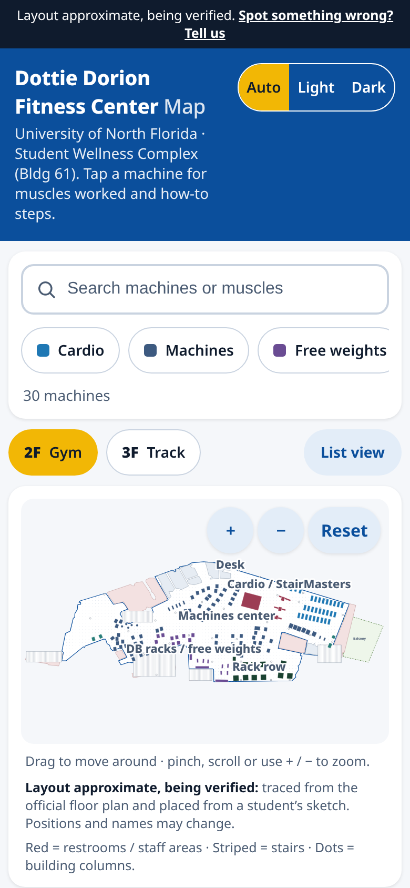

# UNF Gym Map

A free, phone-first map and guide to the 2nd floor of the UNF rec center (Dottie Dorion Fitness Center, Student Wellness Complex) for people who are new to the gym. Tap a machine to see what muscles it works and how to use it.

Live site: https://zacharyflechas.github.io/unf-gym-map/



> This is an unofficial student project. It is not affiliated with or endorsed by the University of North Florida (UNF). Machine positions are approximate.

## Run it on your computer

You need Node 20.19+ (or 22+).

```bash
npm install
npm run dev
```

Then open http://localhost:5173.

Other commands: `npm run build` (build the site into `dist/`), `npm run preview` (view that build), `npm run validate` (check the layout files), `npm test`.

## Update the layout (dev-only editor)

The editor only works with `npm run dev`. It is never part of the live site.

1. Run `npm run dev` and open http://localhost:5173/?edit=1 (use the level dropdown, or add `&level=3f`, for the 3rd floor).
2. Drag items to move them. Click an item to change its name, type, zone, status, linked machine, size or notes. Your edits are saved in your browser until you click **Reset**.
3. Set **Source** (sketch, photos or scan), then click **Export JSON**. This downloads `layout-2f.json`.
4. Replace `src/data/layout-2f.json` with the downloaded file.
5. Run `npm run validate`. Errors must be fixed before the site will build; warnings are OK.
6. Commit on a new branch and open a pull request.

## Where things live

- `src/data/layout-2f.json`: where each machine sits on the map (in feet).
- `src/data/base-2f.json`: the floor itself (walls, rooms, stairs, columns).
- `src/data/gymData.js`: what each machine is (muscles, steps, tips, video).
- `docs/research/`: research notes and sources.

Pushing to `main` publishes the site automatically with GitHub Actions.
