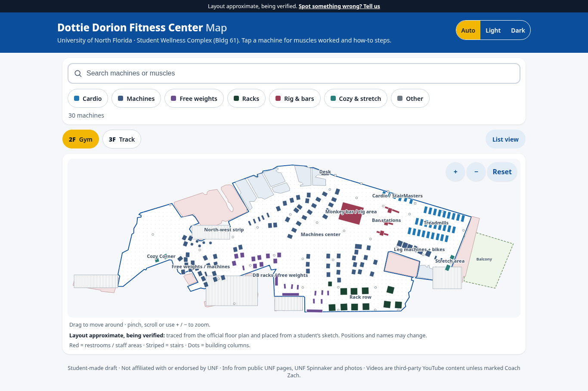

# Rec Center Gym Map (UNF prototype)

An interactive, mobile-friendly gym floor map for students. Tap a machine to see the muscles it works, short how-to steps, tips, and an embedded YouTube tutorial.

> **Draft:** on the `unf-layout-draft` branch, the map is a best-effort draft of the **Dottie Dorion Fitness Center** (2nd floor, Student Wellness Complex, Building 61). It is built from public sources only. The equipment list is mostly sourced, but most **positions are guesses**. Each zone and machine carries `confidence` / `locationConfidence` / `sources` fields. See [`docs/unf-draft-findings.md`](docs/unf-draft-findings.md) for all sources. This project is not affiliated with or endorsed by UNF and uses no UNF logos. **Corrections are welcome:** open an issue.



## Features

- Top-down SVG floor map of the 2nd floor, traced from the official plan (units: feet), with every piece of equipment drawn at its approximate size and clickable (mouse, touch, and keyboard: Tab + Enter). The layout is approximate and still being verified.
- Detail panel: a right-hand drawer on desktop and a bottom sheet on phones. It shows primary/secondary muscles, how-to steps, tips, and a privacy-enhanced `youtube-nocookie.com` embed. If a machine has no `youtubeId`, the panel shows a YouTube search link instead.
- Search by machine name, zone, or muscle, plus one-tap muscle-group chips. Matching machines are highlighted on the map with a gold ring and the rest are dimmed.
- A machine list under the map for big, easy tap targets on phones. On narrow screens the map scrolls sideways.
- Deep links: the URL hash holds the open machine (e.g. `…/#leg-press`). You could print these as QR codes and stick them on the real machines.
- No backend: it builds to a static site.
- Motion, all in plain CSS (transform/opacity only, no animation library):
  - **Load sequence:** the equipment fades in one item after another.
  - **Search matches:** matching items get a gold outline and the rest are dimmed.
  - **Zoom on tap:** the map zooms and pans toward the tapped machine and zooms back out when the panel closes. This is a CSS transform tween on a wrapper, so the horizontal scroll and tap targets still work. On phones the page also scrolls so the zoomed map shows above the bottom sheet.
  - **Panel:** the drawer (desktop) or bottom sheet (phone) springs in using CSS `linear()` spring easing, with a cubic-bezier fallback for older browsers. The backdrop fades.
  - **Hover lift:** on desktop, list rows lift on hover. This only applies under `@media (hover: hover) and (pointer: fine)`.
  - **Reduced motion:** with `prefers-reduced-motion: reduce`, all of the above is turned off and the map doesn't zoom.

## Run locally

Requires Node 20.19+ (or 22+).

```bash
npm install
npm run dev        # http://localhost:5173
npm run build      # production build into dist/
npm run preview    # serve dist/ at http://localhost:4173
```

## Edit the gym data

The data is split into **where things are** and **what they are**:

- **[`src/data/layout-2f.json`](src/data/layout-2f.json)** holds where every item on the 2nd floor sits. Each item is `{ id, name, type, zone, x, y, rotation, width, depth, status, notes, machineId? }`:
  - Units are **feet**. `x`, `y` are the item's center and `rotation` is in degrees clockwise.
  - `status` is one of `guess | sketch | photo-verified | scan-verified`.
  - `machineId` (optional) links the item to an entry in `gymData.js` so tapping it shows muscles, how-to and video. Items without one show a simple "no info yet" panel.
- **[`src/data/base-2f.json`](src/data/base-2f.json)** is the floor plan traced from the official 2nd-floor plan: rec-area outline, rooms, stairs, balcony and structural columns, all in feet. The scale is an **estimate** (28 ft column bay) until a wall is measured.
- **[`src/data/gymData.js`](src/data/gymData.js)** holds what each machine is: `MACHINES` (muscles, steps, tips, `youtubeId`), `ZONES` (names), `MUSCLE_GROUPS` (filter chips) and `FACILITY` (header text, feedback link).

Moving a machine only changes `layout-2f.json`. No component code changes.

### Layout editor (dev only)

```bash
npm run dev
# open http://localhost:5173/?edit=1
```

- **Drag** an item to move it. **Drag the yellow dot** to rotate it (hold Shift for 15° steps).
- **Arrow keys** nudge the selected item 0.5 ft (Shift = 5 ft).
- Click an item to edit its **name, type, zone, status, linked machine, size and notes**. Use **Add item** and **Delete item** to add or remove items.
- **Official plan underlay**: put `plan-2f-straightened.jpg` in [`dev-assets/`](dev-assets/README.md) and toggle it on to see the official plan under the map. The image is git-ignored and never published.
- Edits autosave in your browser (localStorage). **Reset** goes back to the file.
- **Export JSON** downloads `layout-2f.json`. Replace `src/data/layout-2f.json` with it and open a PR.

The editor is loaded with a dynamic `import()` behind `import.meta.env.DEV` (see [`src/main.jsx`](src/main.jsx)), so it is not part of `npm run build`. To check: `npm run build && grep -r LAYOUT_EDITOR_MARKER dist/` should print nothing.

**Adding a video:** check that the ID exists by opening
`https://www.youtube.com/oembed?url=https://www.youtube.com/watch?v=VIDEO_ID&format=json`.
It returns 200 for a real, embeddable video and 401/404 otherwise. If you're not sure about a video, set `youtubeId: null`.

## Deploy to GitHub Pages

1. Push this repo to GitHub with `main` as the default branch.
2. In the repo, go to **Settings → Pages → Build and deployment → Source** and choose **GitHub Actions**.
3. Push to `main`, or run the workflow by hand. [`.github/workflows/deploy.yml`](.github/workflows/deploy.yml) builds with `npm ci && npm run build` and publishes `dist/`.
4. The site will be at `https://<user>.github.io/<repo>/`. For this repo that's https://zacharyflechas.github.io/unf-gym-map/.

### Vite `base` note

Project Pages sites are served from a sub-path (`/<repo>/`), so built asset URLs must include it. The workflow builds with `VITE_BASE=/${{ github.event.repository.name }}/`, which is `/unf-gym-map/` for this repo. [`vite.config.js`](vite.config.js) reads that variable, and falls back to `'./'` (relative paths) for local builds. If you fork or rename the repo, the workflow picks up the new name automatically. For a user/org site (`<user>.github.io`) or a custom domain, use `VITE_BASE=/`.

Live prototype: https://zacharyflechas.github.io/unf-gym-map/

## Screenshots

`npm run screenshots` uses `playwright-core` with a locally installed Chrome (`CHROME_PATH`, default `/usr/bin/google-chrome`). It expects `npm run preview` to be running on port 4173. Output goes to [`screenshots/`](screenshots/).
`npm run demo` records demo videos (`screenshots/demo-desktop.webm` and `screenshots/demo-mobile.webm`, which git ignores). It needs Playwright's ffmpeg, installed once with `npx playwright-core install ffmpeg`.

## Stack

React 19 + Vite 8 in plain JavaScript, with one plain CSS file (`src/styles.css`, colors in CSS variables: navy `#004B87` and grays). There are no UI libraries and no backend.

## Video credits

Each tutorial embed belongs to its YouTube creator: Naomi Kong, Planet Fitness, Concept2, Matrix Fitness, Morgan M.S. CPT, NASM, ATHLEAN-X, Max Euceda, Sewell Fitness, The Muscle Mentors, Onnit, Buff Dudes, and ScottHermanFitness. The how-to text in this app is general guidance, not medical advice.
